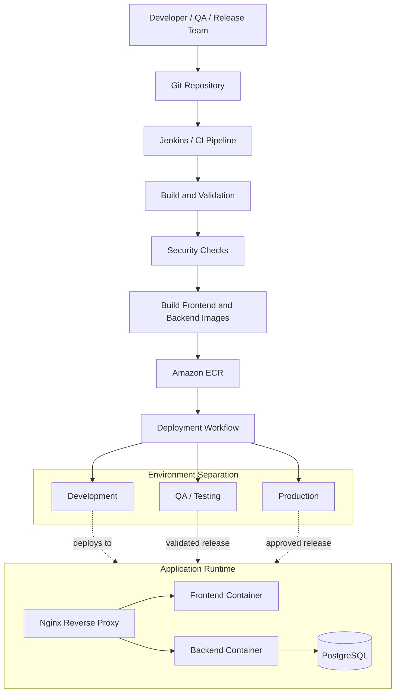
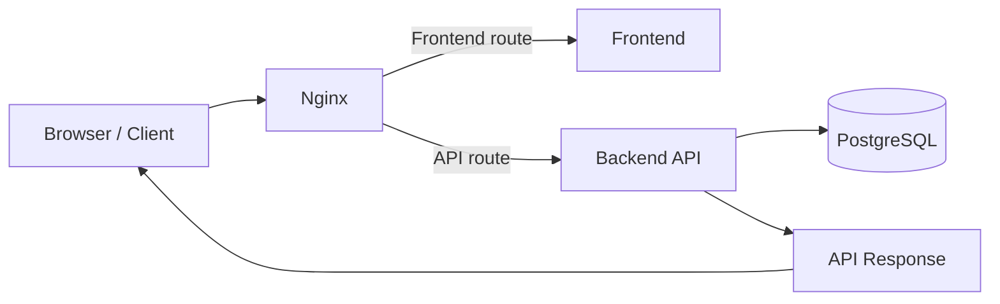
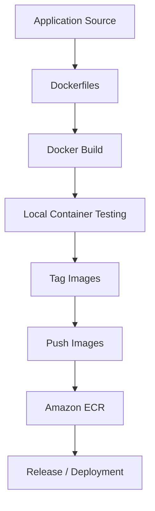

<div align="center">

# 👋 Hi, I'm Rohit Thakur

### DevOps Engineer · DevSecOps Engineer · Cloud Engineer · FinOps

**Building reliable cloud platforms, secure delivery pipelines, and automation that teams can trust.**

[](https://www.linkedin.com/in/rohit-kr-thakur07)
[](https://github.com/THAKUR-ROHIT-21)
[](mailto:thakurrohitkr591@gmail.com)

</div>

---

## 🚀 About Me

I'm a DevOps / DevSecOps Engineer with **5+ years of experience** working across AWS, Azure, and GCP. I enjoy turning manual infrastructure and deployment processes into repeatable, secure, observable workflows.

- ☁️ Cloud: AWS, Microsoft Azure, and Google Cloud Platform
- 🏗️ Infrastructure as Code: Terraform, Ansible, and CloudFormation
- 📦 Containers: Docker, Docker Compose, Kubernetes, and Helm
- 🔁 CI/CD & GitOps: Jenkins, GitHub Actions, and Argo CD
- 🔐 DevSecOps: SonarQube, Trivy, Gitleaks, and OWASP ZAP
- 📈 Monitoring: Prometheus, Grafana, Alertmanager, and cloud-native monitoring
- 💰 FinOps: tagging, budgets, rightsizing, utilization reviews, and cost visibility
- 🧰 Scripting: Bash, Python, and Linux

**My engineering focus:** automation, Kubernetes, Terraform, secure CI/CD, production reliability, and cost-aware cloud operations.

---

## 🧭 What I Work On

| Area | What I build |
|---|---|
| Cloud infrastructure | Secure VPC/VNet networks, compute, storage, databases, IAM, and managed services |
| Infrastructure automation | Reusable Terraform modules, remote state workflows, and Ansible automation |
| CI/CD | Build, test, scan, package, publish, and deploy workflows |
| Kubernetes & GitOps | Container orchestration, Helm releases, deployment strategies, and Argo CD sync |
| DevSecOps | Source-code, dependency, container-image, and secret scanning |
| Observability | Metrics, dashboards, logs, alerts, and incident troubleshooting |
| FinOps | Cost allocation, budget alerts, rightsizing, scheduled shutdowns, and spend reviews |

---

## 🧰 Technology Stack

<div align="center">


</div>

<details>
<summary><strong>View detailed tools and services</strong></summary>

- **AWS:** EC2, S3, IAM, VPC, RDS, ECR, ECS, EKS, Lambda, CloudWatch, Route 53, CloudFront, ELB/ALB, Auto Scaling, SNS
- **Azure:** Virtual Machines, VNet, Blob Storage, ACR, AKS, ACI, App Service, Entra ID, Azure Monitor, DNS, CDN, Key Vault
- **GCP:** Compute Engine, GCS, IAM, VPC, GKE, Cloud SQL, Cloud Run, Cloud Monitoring, Cloud Logging, Artifact Registry
- **IaC & configuration:** Terraform modules, variables, state management, Ansible playbooks and roles, CloudFormation
- **Containers:** Docker, Docker Compose, Kubernetes, Helm, Ingress
- **CI/CD & GitOps:** Jenkins, GitHub Actions, Argo CD, Flux, Git, GitHub, GitLab
- **Security:** SonarQube, Trivy, OWASP ZAP, Gitleaks
- **Messaging:** Apache Kafka, producers, consumers, brokers, topics, partitions, consumer groups
- **Observability:** Prometheus, Grafana, Alertmanager, CloudWatch, Azure Monitor, ELK Stack
- **FinOps:** AWS Cost Explorer, Budgets, CUR, Cost Anomaly Detection, Compute Optimizer, Savings Plans, Reserved Instances, Azure Cost Management, GCP Billing, Kubecost, Infracost
- **Scripting & systems:** Bash, Python, Ubuntu, Debian, Nginx, reverse proxy, SSL/TLS

</details>

---

# 🏗️ Featured Project

## Dev, QA & Production Collaboration Platform

**A multi-environment application delivery platform designed to make development, testing, and production deployments more consistent and repeatable.**

[](https://www.docker.com/)
[](https://aws.amazon.com/ecr/)
[](https://www.postgresql.org/)
[](https://developer.hashicorp.com/terraform)
[](https://kubernetes.io/)

### 🎯 Project goals

- Separate application configuration and deployment environments for **Dev, QA, and Production**.
- Package frontend and backend services into Docker images.
- Use a consistent image-publishing workflow with Amazon ECR.
- Route application traffic through Nginx.
- Keep PostgreSQL data in a dedicated database service.
- Automate infrastructure and delivery steps as the platform evolves.
- Improve release repeatability, troubleshooting, and deployment confidence.

### 🧩 High-level architecture



> **Architecture note:** The diagram shows the target delivery flow. Keep only the stages and services that are implemented in your repository; mark the remaining items as planned until they are deployed and tested.

### 🔄 Application request flow



### 📦 Container and image workflow



### 🛠️ Key engineering work

- Containerized the frontend and backend services with Docker.
- Connected application services through a dedicated Docker network.
- Configured Nginx as the entry point / reverse proxy for application traffic.
- Connected the backend service to PostgreSQL using environment-based configuration.
- Built and tested the application locally with Docker Compose.
- Tagged and published application images to Amazon ECR.
- Worked on AWS networking concepts including VPCs, public/private subnets, and security groups.
- Structured the platform around separate Dev, QA, and Production environments.
- Preparing the Kubernetes deployment path with EKS, including workload manifests and service exposure.
- Planning reusable Terraform modules and automated CI/CD stages for repeatable infrastructure and releases.

### 🧱 Environment promotion model

| Environment | Purpose | Promotion rule |
|---|---|---|
| **Development** | Developer integration and early testing | Frequent changes |
| **QA** | Functional and release validation | Promote after Dev checks |
| **Production** | Approved application release | Promote after QA sign-off |

### 🔐 Security and reliability checklist

- [ ] Keep secrets outside source code; use a secret manager or protected CI/CD variables.
- [ ] Apply least-privilege IAM roles and security-group rules.
- [ ] Scan source code and dependencies before release.
- [ ] Scan Docker images before publishing or deployment.
- [ ] Use TLS for public application traffic.
- [ ] Configure database backups and test restoration.
- [ ] Add health checks, logs, metrics, and alerting.
- [ ] Use resource requests/limits and deployment health checks in Kubernetes.
- [ ] Review cloud costs and remove unused resources.

### ▶️ Run locally

> Run these commands from the repository root. Confirm the actual Compose filename and required environment variables in your project before running.

```bash
# 1. Clone your repository
# Replace <YOUR-REPOSITORY-URL> with the actual GitHub repository URL
 git clone <YOUR-REPOSITORY-URL>
 cd <YOUR-REPOSITORY-FOLDER>

# 2. Review the available files and environment configuration
ls -la
find . -maxdepth 2 -type f | sort

# 3. Build and start services (if your repository has compose.yaml)
docker compose up -d --build

# 4. Check running containers
docker compose ps

# 5. Follow application logs
docker compose logs -f

# 6. Stop the services
docker compose down
```

If your Compose file has a different name, run it with `docker compose -f <compose-file> up -d --build`.

### ☁️ Amazon ECR image publishing

Set your own AWS region, account ID, repository, and image tags. The values below reflect the ECR repository used during this project; verify that it still exists in your AWS account.

```bash
export AWS_REGION="eu-north-1"
export AWS_ACCOUNT_ID="258408902605"
export ECR="${AWS_ACCOUNT_ID}.dkr.ecr.${AWS_REGION}.amazonaws.com"
export REPO="platformf_or_dev_qa_prod"

# Authenticate Docker to ECR
aws ecr get-login-password --region "$AWS_REGION" \
  | docker login --username AWS --password-stdin "$ECR"

# Tag local images (adjust source image names if yours differ)
docker tag backend-backend:latest "$ECR/$REPO:backend-v1"
docker tag frontend-frontend:latest "$ECR/$REPO:frontend-v1"

# Push images
docker push "$ECR/$REPO:backend-v1"
docker push "$ECR/$REPO:frontend-v1"
```

### 📁 Suggested repository structure

```text
Team-collaboration-platforms/
├── frontend/
│   ├── Dockerfile
│   └── src/
├── backend/
│   ├── Dockerfile
│   └── src/
├── nginx/
│   └── nginx.conf
├── database/
│   └── init/
├── docker-compose.yml
├── .env.example
├── terraform/
│   ├── modules/
│   └── environments/
│       ├── dev/
│       ├── qa/
│       └── prod/
├── k8s/
│   ├── base/
│   └── overlays/
│       ├── dev/
│       ├── qa/
│       └── prod/
├── Jenkinsfile
└── README.md
```

This is a suggested layout, not a claim that every folder already exists. Adapt it to the actual repository.

### 🖼️ Screenshots and visual evidence

Add real screenshots from your running project to a `docs/images/` folder and keep these filenames, or update the paths below:

| Screenshot | Suggested file |
|---|---|
| Application home page | `docs/images/application-home.png` |
| Docker containers running | `docs/images/docker-containers.png` |
| Docker Compose services | `docs/images/docker-compose.png` |
| Amazon ECR repositories and images | `docs/images/amazon-ecr.png` |
| AWS VPC and subnet layout | `docs/images/aws-network.png` |
| Kubernetes workloads (after EKS deployment) | `docs/images/eks-workloads.png` |
| CI/CD pipeline execution | `docs/images/ci-cd-pipeline.png` |

Example image embed:

```md

```

Do not leave broken image links in the published README. Add each screenshot after capturing it, and remove any row for a feature that is not yet implemented.

---

# 🌐 Other Portfolio Projects

## 1. Enterprise E-Commerce Microservices Platform — AWS

**Focus:** Kubernetes, EKS, Terraform, GitOps, CI/CD, DevSecOps, monitoring, and performance.

- Designed infrastructure using VPC, EKS, RDS, ElastiCache, S3, CloudFront, ALB, and ECR.
- Used Terraform modules to standardize infrastructure across environments.
- Structured Kubernetes releases with Helm and Argo CD.
- Built CI/CD stages for build, validation, security scanning, and image publishing.
- Worked with SonarQube, Trivy, Gitleaks, and OWASP ZAP in the delivery workflow.
- Used Prometheus, Grafana, and CloudWatch for operational visibility.
- Applied rightsizing and scaling reviews to improve cost efficiency.

## 2. Enterprise Healthcare Management Platform — Azure Serverless

**Focus:** Event-driven services, API security, identity, automation, and observability.

- Designed an event-driven solution using Azure Functions, Service Bus, and Event Grid.
- Used API Management to expose and govern application APIs.
- Applied Key Vault, Microsoft Entra ID, and Azure RBAC for access control.
- Automated infrastructure with Terraform and delivery with Azure DevOps / GitHub Actions.
- Used Application Insights and Azure Monitor to review service health and failures.
- Considered consumption-based services to reduce always-on infrastructure costs.

## 3. Customer Management Platform — GCP

**Focus:** GKE, Cloud Run, Cloud SQL, IAM, automation, and recovery.

- Structured GCP networking with VPCs, subnets, firewall rules, and Cloud NAT.
- Worked with GKE, Compute Engine, Cloud SQL, and Cloud Run.
- Applied service accounts, least-privilege IAM, and workload identity concepts.
- Automated build and deployment workflows with Jenkins and GitHub Actions.
- Used Cloud Monitoring and Cloud Logging for operational visibility.
- Reviewed Cloud SQL backup and point-in-time recovery options.

## 4. Multi-Cloud Application Deployment & FinOps Platform

**Focus:** AWS, Azure, GCP, Terraform, cost visibility, and optimization.

- Defined cost-allocation tags for environment, team, project, and owner.
- Worked with AWS CUR, Athena, QuickSight, Azure Cost Management, and GCP Billing export concepts.
- Used budgets and anomaly alerts to identify unexpected spend.
- Reviewed compute rightsizing, storage lifecycle, and non-production shutdown opportunities.
- Explored Kubecost for Kubernetes namespace-level cost visibility and Infracost for Terraform change estimates.

---

## 📚 Currently Improving

- Advanced Kubernetes troubleshooting and production operations
- Terraform module design, state management, and infrastructure automation
- DevSecOps pipeline design and security gates
- Cloud networking, high availability, and disaster recovery
- FinOps practices for multi-cloud and Kubernetes environments

## 🤝 Let's Connect

I'm interested in opportunities and conversations around **DevOps, DevSecOps, Cloud Engineering, Platform Engineering, SRE, and FinOps**.

- 📍 East Delhi, India
- 📧 [thakurrohitkr591@gmail.com](mailto:thakurrohitkr591@gmail.com)
- 💼 [LinkedIn](https://www.linkedin.com/in/rohit-kr-thakur07)
- 🧑‍💻 [GitHub](https://github.com/THAKUR-ROHIT-21)

---

<div align="center">

**Thanks for visiting my profile!**

⭐ If you find my projects useful, feel free to explore the repositories and share feedback.

</div>
