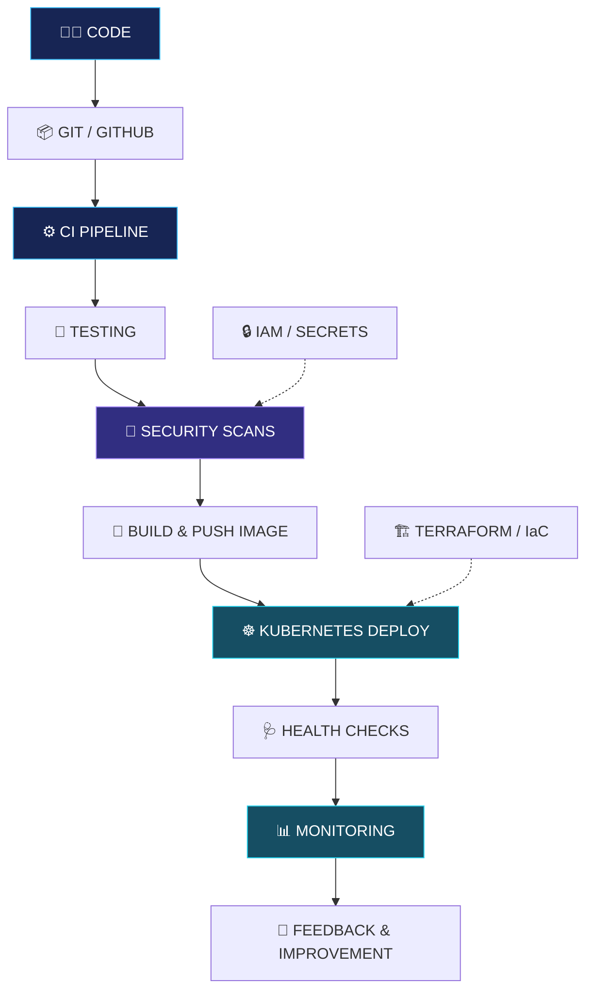

<p align="center">
  
</p>
<!-- ═══════════════ HERO SECTION ═══════════════ -->

<!-- <div align="center">


<a href="https://readme-typing-svg.demolab.com">
  
</a>

<br/>


<br/><br/>

<a href="https://github.com/THAKUR-ROHIT-21">
  
</a>
<a href="https://www.linkedin.com/in/rohit-kr-thakur07/">
  
</a>

</div> -->

---

<!-- ═══════════════ ABOUT ═══════════════ -->

## `01` // WHO AM I?

```bash
rohit@devops:~$ whoami

DevOps Engineer | Cloud Infrastructure | Automation

rohit@devops:~$ cat mission.txt

Automate repetitive work.
Build secure and reliable infrastructure.
Ship software with confidence.
Monitor everything that matters.
Continuously improve system reliability.
```

I'm a **DevOps Engineer with 4.5+ years of experience** working with cloud infrastructure, containerized applications, CI/CD automation, and modern DevOps practices.

- ☁️ **Cloud:** AWS, Microsoft Azure & Google Cloud
- ☸️ **Containers:** Docker, Kubernetes, Helm
- 🏗️ **Infrastructure as Code:** Terraform, Ansible
- 🔄 **CI/CD & GitOps:** Jenkins, GitHub Actions, Argo CD
- 🔐 **DevSecOps:** SonarQube, Trivy, Gitleaks
- 📊 **Observability:** Prometheus, Grafana, CloudWatch
- 🐧 **Automation:** Linux, Bash, Python
- 🧠 **Exploring:** MLOps, cloud-native security and platform engineering

---

<!-- ═══════════════ TECH STACK ═══════════════ -->

## `02` // MY TECHNOLOGY ARSENAL

<div align="center">

### ☁️ CLOUD ENGINEERING


### ☸️ CONTAINERS & ORCHESTRATION


### 🏗️ INFRASTRUCTURE & AUTOMATION


### 🔄 CI/CD & VERSION CONTROL


### 📈 MONITORING & OBSERVABILITY


</div>

---

<!-- ═══════════════ DEVOPS PIPELINE ═══════════════ -->

## `03` // HOW I THINK ABOUT DEVOPS

<div align="center">



</div>

> My approach: **Automate → Test → Secure → Deploy → Verify → Observe → Improve.**

---

<!-- ═══════════════ PROJECTS ═══════════════ -->

## `04` // PROJECTS & ENGINEERING LABS

<table>
<tr>
<td width="50%" valign="top">

### 🏦 AWS Banking Application


Three-tier banking application with an EC2 application tier and a private RDS database.

**Engineering highlights**
- VPC and security-group configuration
- Private database connectivity
- Systems Manager and port forwarding
- Load balancing, DNS and HTTPS components

**Stack:** AWS · EC2 · RDS · IAM · SSM · ALB

<a href="https://github.com/THAKUR-ROHIT-21/banking-app-Three-tier-deployment">↗ VIEW PROJECT</a>

</td>
<td width="50%" valign="top">

### ☸️ HireFlow — Kubernetes & GitOps


Hands-on application platform work with a self-managed Kubernetes environment.

**Engineering highlights**
- Kubernetes workloads and services
- Ingress and persistent storage
- Argo CD synchronization workflows
- Application health and monitoring

**Stack:** Kubernetes · Helm · Argo CD · Prometheus · Grafana

<a href="https://github.com/THAKUR-ROHIT-21/hireflow-gitops-latest">↗ VIEW PROJECT</a>

</td>
</tr>
<tr>
<td width="50%" valign="top">

### 🔐 DevSecOps CI/CD


Security-focused CI/CD workflow integrating code and secret scanning with container security checks.

**Engineering highlights**
- GitHub Actions workflows
- SonarQube analysis
- Gitleaks secret detection
- Trivy container image scanning

**Stack:** GitHub Actions · Docker · SonarQube · Gitleaks · Trivy

<a href="https://github.com/THAKUR-ROHIT-21/DevSecOps_file">↗ APPLICATION REPO</a> · <a href="https://github.com/THAKUR-ROHIT-21/SecOps">SECURITY REPO</a>

</td>
<td width="50%" valign="top">

### ☁️ GCP Three-Tier Deployment


Cloud deployment project focused on a Three-tier application architecture on Google Cloud.

**Engineering focus**
- Cloud infrastructure
- Networking and compute
- Application deployment
- Infrastructure troubleshooting

**Stack:** Google Cloud · Compute · Networking

<a href="https://github.com/THAKUR-ROHIT-21/gcp_Three_tier_deployment">↗ VIEW PROJECT</a>

</td>
</tr>
</table>

---

<!-- ═══════════════ ENGINEERING PRINCIPLES ═══════════════ -->

## `05` // PRODUCTION MINDSET

<div align="center">

| Engineering area | What matters |
|:---|:---|
| 🛡️ Security | Least privilege, secret protection, image scanning |
| ⚙️ Automation | Repeatable pipelines and Infrastructure as Code |
| ☸️ Reliability | Health checks, safe deployments, recovery planning |
| 📊 Observability | Metrics, dashboards, alerts and troubleshooting |
| 💰 Efficiency | Right-sized infrastructure and cost awareness |
| 🔁 Delivery | Testing, deployment verification and rollback planning |

</div>

---

<!-- ═══════════════ GITHUB ANALYTICS ═══════════════ -->

## `06` // GITHUB COMMAND CENTER

<div align="center">


<br/>


<br/>


</div>

---

<!-- ═══════════════ CURRENT FOCUS ═══════════════ -->

## `07` // CURRENTLY BUILDING MY SKILLS

```yaml
learning:
  cloud:
    - AWS
    - Azure
    - GCP

  platform_engineering:
    - Kubernetes
    - Terraform
    - GitOps
    - CI/CD

  security:
    - Container_scanning
    - Secret_detection
    - IAM_and_RBAC

  reliability:
    - Prometheus
    - Grafana
    - Troubleshooting
    - Deployment_health_checks
```

---

## `08` // LET'S CONNECT

<div align="center">

**Interested in Cloud, DevOps, Kubernetes, automation and secure delivery?**

<a href="https://www.linkedin.com/in/rohit-kr-thakur07/">
  
</a>
<a href="https://github.com/THAKUR-ROHIT-21">
  
</a>

<br/><br/>


**`AUTOMATE EVERYTHING. SECURE EVERY RELEASE. IMPROVE EVERY DAY.`**

</div>
